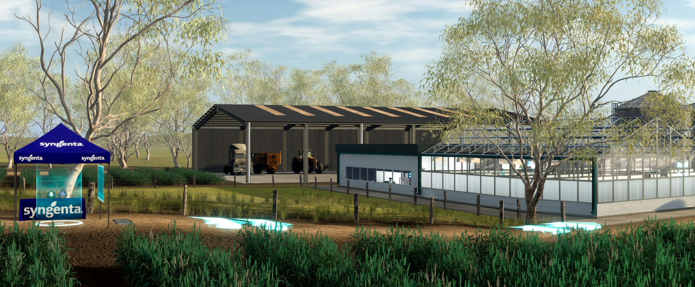
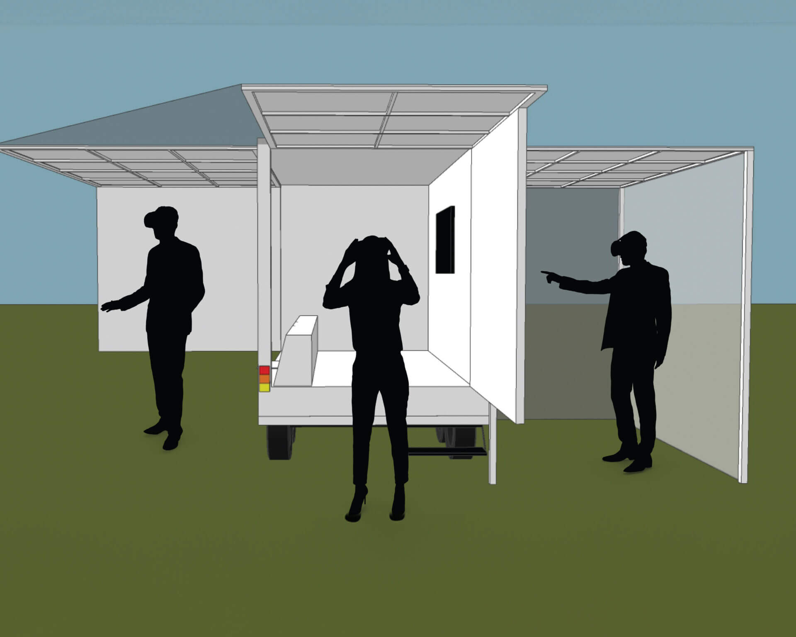
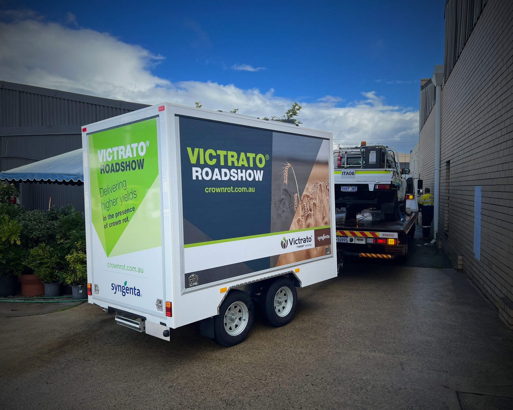
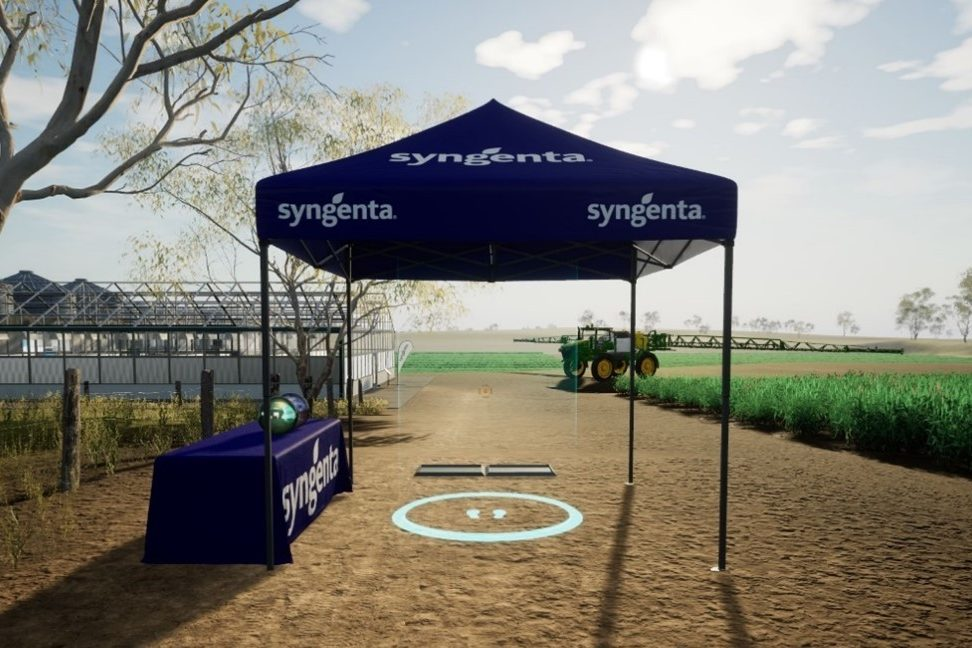

<!---
slug: must match link: URL in .Work.js
-->

As virtual technologies improve, it is becoming possible to explore increasingly realistic environments. In this project sponsored by agricultural company Syngenta Australia, the 3DVAL created a digital educational experience that replicates on-site learnings gathered at Syngenta’s physical learning centres across the country.

In this immersive VR experience, users can explore wheat fields and learn about the impact of Crown Rot – a fungal disease that can be devastating to the global wheat industry. Users learn about the disease cycle, mechanisms leading to poor crop yields, and how Syngenta products can treat the disease to reduce the impact of Crown Rot.

In parallel to the development of the VR application, UNSW is completing a research study evaluating the effectiveness of different learning scenarios in a cohort of volunteers. The study will compare learning outcomes in VR compared to traditional screen-based methods and shed light on interfaces and immersive VR scenarios that offer the greatest knowledge transfer to the viewers.

Collaborators: Richard Packard (Syngenta Australia), Pat Younis &amp; Jordan East (Tilde Visual) 
Funded by: Syngenta Australia

